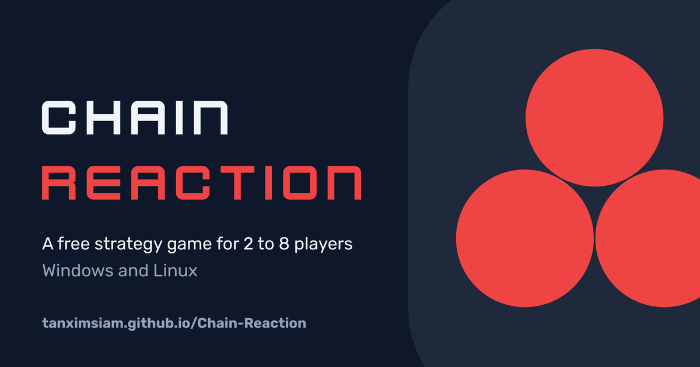
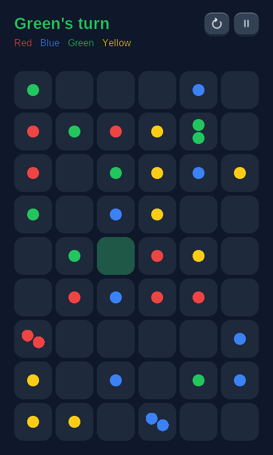
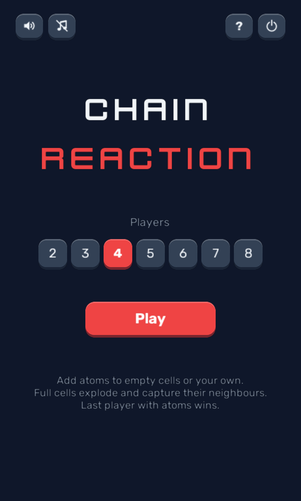
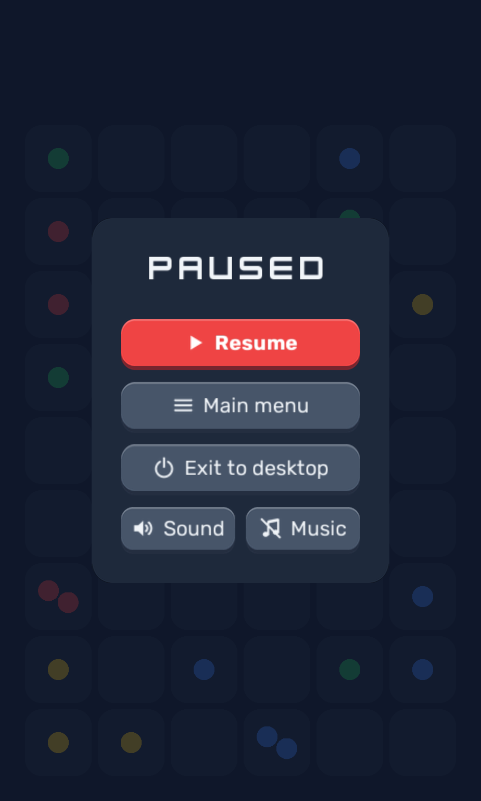

<a href="https://tanximsiam.github.io/Chain-Reaction/"></a>

<p align="center">
A free strategy game for 2 to 8 players on one computer.<br>
Push a cell past its limit and it bursts into its neighbours, taking them over.
</p>

<p align="center">
<a href="https://tanximsiam.github.io/Chain-Reaction/"><b>Game page</b></a> ·
<a href="https://github.com/tanximsiam/Chain-Reaction/releases/latest"><b>Download</b></a> ·
<a href="#how-to-play">How to play</a> ·
<a href="#run-from-source">Run from source</a>
</p>

<p align="center">



</p>

## Download

| Platform | File | How to run |
|---|---|---|
| Windows | [`ChainReaction-windows.exe`](https://github.com/tanximsiam/Chain-Reaction/releases/latest/download/ChainReaction-windows.exe) (19 MB) | Double-click. The exe isn't code-signed, so SmartScreen may warn: choose *More info → Run anyway*. |
| Linux | [`ChainReaction-linux.tar.gz`](https://github.com/tanximsiam/Chain-Reaction/releases/latest/download/ChainReaction-linux.tar.gz) (39 MB) | `tar -xzf ChainReaction-linux.tar.gz && ./ChainReaction`. Needs OpenGL 3.3. |

Nothing to install. Every version is on the [releases page](https://github.com/tanximsiam/Chain-Reaction/releases).

## How to play

1. On your turn, add one atom to an empty cell or one of your own.
2. A cell bursts when it holds as many atoms as it has neighbours: **2 in a corner, 3 on an edge, 4 in the middle**.
3. A burst sends one atom to each neighbour, and every cell it lands in becomes yours.
4. Neighbours that fill up burst too, so one move can run right across the board.
5. After your first move, losing every atom knocks you out. The last colour standing wins.

The in-game **How to play** screen shows each rule with an animated demo board.

| Where | Key | Action |
|---|---|---|
| Menu | Click, Left / Right, or 2 to 8 | Choose the number of players |
| Menu | Enter or Space | Start |
| Game | Click a cell | Place an atom |
| Game | R | Restart |
| Game | Esc or P | Pause menu: Resume, Main menu, Exit to desktop, Sound, Music |

## Run from source

Needs Python 3.12.

```bash
python -m venv venv
venv/bin/pip install -r requirements.txt
venv/bin/python main.py
```

On Windows use `venv\Scripts\pip` and `venv\Scripts\python` instead.

## Development

| Task | Command |
|---|---|
| Tests | `venv/bin/python -m unittest test_board` |
| Live preview | `venv/bin/python tools/live_preview.py`, then open http://localhost:8765. It runs the game in a browser tab and restarts whenever a `.py` file changes. |
| Build a binary | `venv/bin/pip install pyinstaller`, then `venv/bin/pyinstaller --noconfirm ChainReaction.spec`. The one-file binary lands in `dist/`. |
| Release | Push a tag like `v1.1.0`. [`release.yml`](.github/workflows/release.yml) runs the tests, builds Windows and Linux binaries and publishes a release. |
| Website | Edit `site/`. [`pages.yml`](.github/workflows/pages.yml) publishes it to GitHub Pages when it changes on `main`. |

Work happens on feature branches merged into `dev` through pull requests; `dev` is merged into `main` for releases.

### Project layout

| Path | What it holds |
|---|---|
| `main.py` | Entry point: window, icon, start menu |
| `board.py` | Game rules only: board, explosion waves, turns, elimination |
| `board_sprites.py` | `BoardSprites`: tiles, atoms and explosion animation for any board, at any size |
| `game_view.py` | Game screen: input, turns, HUD, pause menu, game over |
| `menu_view.py` | Start menu |
| `manual_view.py` | How to play, with looping demo boards |
| `widgets.py` | `BevelButton` (rounded, bevelled, animated), tooltips, panels, audio toggles |
| `ui_theme.py` | Fonts, colours and rounded nine-patch textures |
| `icons.py` | Stroke icon set, drawn once with Pillow |
| `audio.py` | Sound effects, music and their on/off settings |
| `constants.py` | Board size, layout, timings and player colours |
| `test_board.py` | Unit tests for the rules |
| `assets/` | App icon (`.png` for the window, `.ico` for the exe) |
| `ChainReaction.spec` | PyInstaller build settings |
| `site/` | The GitHub Pages download site, with a playable mini board |
| `tools/` | Live browser preview for development |

## Credits

- Built with [Python Arcade](https://api.arcade.academy/) (MIT).
- Sound effects, music and the Kenney Future font by [Kenney](https://kenney.nl/) (CC0), bundled with Arcade.
- Text set in [Rubik](https://github.com/googlefonts/rubik) (SIL Open Font License, see `assets/fonts/OFL.txt`).

## License

The game code is released under the [MIT License](LICENSE), © 2026 Tanzim Siam.
The bundled fonts and sounds keep their own licences, listed under Credits: Kenney assets are CC0 and Rubik is under the SIL Open Font License (`assets/fonts/OFL.txt`).
